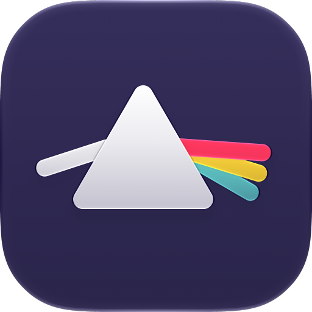

<p align="center"></p>

# Prism

Take the vocals out of anything.

Prism is a realtime stem-splitter for Mac, allowing you to take vocals out of any audio, as it plays. Turn the singer off in Spotify, Apple Music, YouTube or any app, and keep the song.

**[Download Prism for Mac](https://github.com/mattfalconer/prism/releases/latest/download/Prism.dmg)** · macOS 26 or later · Apple silicon

More at [prism.mattfalconer.com](https://prism.mattfalconer.com).

## Presets

- **Original:** the song as recorded.
- **Instrumental:** everything except the vocals.
- **Karaoke:** the vocals turned down to a faint guide, so you can sing the lead.
- **A Cappella:** only the vocals.
- **Rhythm:** only the drums and bass.

Every stem also has its own level, mute and solo.

## Good to know

- Prism works with Spotify, Apple Music, YouTube, TIDAL, Deezer, Amazon Music, Safari and Chrome, or every sound your Mac makes with All Mac Audio.
- It needs a one-time 699 MB download to split music. After that it works offline, and nothing you play is uploaded.
- It plays a few seconds behind the original: about 1.5 seconds (Responsive), 3 (Balanced) or 6 (Studio).

## How it works

- Prism taps the chosen app's audio (or the whole Mac's) with a Core Audio process tap, which mutes the original while Prism plays its own mix.
- `Packages/StemSeparation` splits the stream into six stems on the GPU with MLX: BS-Roformer, run a few seconds behind real time by `StreamingSeparator`.
- The mixer applies the preset and each stem's level, mute and solo, and plays the result.
- On first run Prism downloads the public BS-Roformer SW checkpoint (699 MB), checks its SHA-256 and converts it to MLX weights in `~/Library/Application Support/Prism/Models`.

## Build it yourself

You need a Mac with Apple silicon, macOS 26, Xcode 26 with the Metal Toolchain (`xcodebuild -downloadComponent MetalToolchain`) and [XcodeGen](https://github.com/yonaskolb/XcodeGen) (`brew install xcodegen`).

```sh
git clone https://github.com/mattfalconer/prism
cd prism/Prism
xcodegen generate
open Prism.xcodeproj
```

Choose your own team under Signing & Capabilities (or set `DEVELOPMENT_TEAM` in `project.yml`), then run. The first time Prism listens to an app, macOS asks for permission to capture its audio.

`Packages/StemSeparation` is a standalone Swift package. Its tests that need the model read file paths from environment variables; see the top of `StemSeparationTests.swift`.

## Licence

Prism is free software under the GNU General Public License v3.0; see [`LICENSE`](LICENSE). Credits for the code it builds on are in [`THIRD_PARTY_NOTICES.md`](THIRD_PARTY_NOTICES.md).

The website lives in `docs/` and is served at [prism.mattfalconer.com](https://prism.mattfalconer.com).
